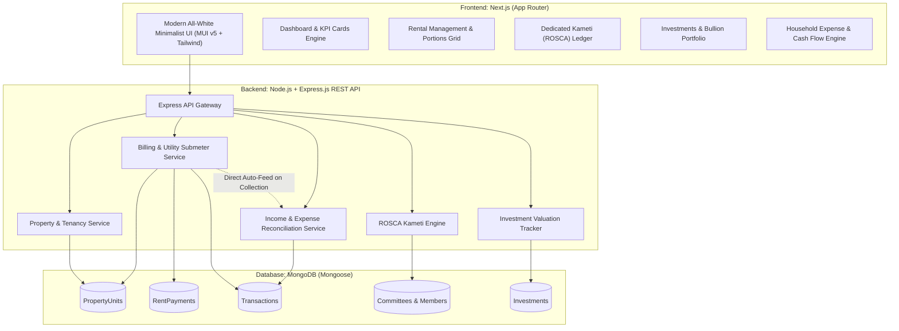

# Household Financial & Rental Management System (Bait-ul-Maal)
### Architecture Blueprint, Data Schemas, API Contracts & Implementation Guide

---

## 1. System Architecture Overview

---

## 2. Database Models & Schema Design (Mongoose)

### 2.1 `PropertyUnit`
Tracks real estate portions/units, lease terms, security deposits, and baseline utility meter readings.
- **Portion Name**: (e.g., *Ground Floor (3-Bed Main)*, *Upper Portion (2-Bed Luxury)*, *Rooftop Studio*).
- **Unit Code**: Unique identifier (e.g. `GF-01`, `UP-01`).
- **Base Monthly Rent**: PKR value.
- **Tenant Subdocument**:
  - `name`: string
  - `phone`: string
  - `securityDeposit`: number
  - `agreementStartDate`: Date
  - `isActive`: boolean
- **Sub-meter tracking**: Electric & Gas meter reading snapshots.

### 2.2 `RentPayment`
Monthly rent invoices, utility splits, and collection status.
- **Unique Compound Index**: `{ unitId: 1, year: 1, month: 1 }` prevents double billing.
- **Utility Split Details**:
  - `electricUnitsConsumed`, `electricRatePerUnit`, `electricTotal`
  - `gasCharge`
  - `maintenanceOrWater`
- **Total Billed Amount**: `baseRent + electricTotal + gasCharge + maintenance`.
- **Payment Lifecycle**: `amountPaid`, `balanceRemaining`, `status` (`Pending` | `Partially Paid` | `Received`).
- **Direct Integration Hook**: Pre-save calculates balances and on collection generates a linked `Transaction` record into Primary Household Income.

### 2.3 `Transaction`
Central ledger for primary income and categorized household expenses.
- **Type**: `INCOME` | `EXPENSE`
- **Categories**:
  - Income: `Salary`, `Rental Inflow`, `Business / Freelance`, `Investment Return`, `Committee Payout`, `Other Income`.
  - Expenses: `Groceries`, `Utilities`, `Maintenance`, `Medical`, `Education`, `Committee Contribution`, `Miscellaneous`.
- **Indexed on**: `{ type: 1, year: 1, month: 1 }` and `{ category: 1, year: 1, month: 1 }` for instant aggregation.

### 2.4 `Committee` & `CommitteeMember` (ROSCA / Kameti)
- **Monthly Pool Value**: Dynamic aggregate of all members' monthly contributions (e.g., 280,000 PKR).
- **Total Lifecycle Value**: `monthlyPool * totalMonths` (e.g., 2,800,000 PKR).
- **Seed Ledger Data Included**:
  1. **Shadia Aunty**: 50,000 PKR / month (Month 1 Payout: Disbursed)
  2. **Asma Aunty**: 110,000 PKR / month (Month 2 Payout: Disbursed)
  3. **Nono ki Ami**: 40,000 PKR / month (Month 5 Payout: **Active / Scheduled this month**)
  4. **Anabia ki Dadi**: 70,000 PKR / month (Month 7 Payout: Scheduled)
  5. **Tehmina Bhabhi**: 10,000 PKR / month (Month 9 Payout: Scheduled)
  *Total Pool: 280,000 PKR / month*
- **Installment Schedule**: Monthly payment records with status flags (`Paid`, `Pending`, `Overdue`).
- **Payout (Niklne ka Mahina) Tracking**: Scheduled draw dates, beneficiary tracking, and disbursement verification.

### 2.5 `Investment`
- **Asset Classes**: Stocks/Mutual Funds, Physical Gold/Silver, Real Estate/Land, National Savings/Fixed Deposits, Crypto.
- **Valuation Tracking**: `investedCapital` vs `currentValuation`, auto-computed `unrealizedReturn` and `returnPercentage`.

---

## 3. REST API Contracts

| Method | Endpoint | Description |
| :--- | :--- | :--- |
| `GET` | `/api/dashboard/metrics?year=2026&month=10` | Aggregated KPI cards, net savings ratio, cashflow summary |
| `GET` | `/api/properties` | List all portions with tenancy & submeter stats |
| `POST` | `/api/properties` | Create new portion with tenant details |
| `GET` | `/api/rent?year=2026&month=10` | Get current month billing and collection status |
| `POST` | `/api/rent/bill` | Generate monthly bill with utility sub-meter splits |
| `POST` | `/api/rent/collect` | **Collect rent**, update status, and **auto-feed into Primary Income** |
| `GET` | `/api/transactions?year=2026&month=10` | Filtered transaction ledger |
| `POST` | `/api/transactions` | Add categorized household expense or income record |
| `GET` | `/api/transactions/summary/monthly` | Cashflow category breakdown |
| `GET` | `/api/investments` | Portfolio valuation summary and asset breakdown |
| `POST` | `/api/investments` | Register investment asset position |
| `GET` | `/api/committees` | ROSCA committees, pool statistics, member matrices |
| `PUT` | `/api/committees/members/:id/contribution` | Inline toggle of contribution (`Paid`, `Pending`, `Overdue`) |
| `PUT` | `/api/committees/members/:id/payout` | Mark member payout disbursed (`isPayoutCompleted`) |

---

## 4. Minimalist All-White UI Design Standards

1. **Background**: Pure `bg-white` canvas with subtle neutral container backgrounds (`bg-slate-50/50`).
2. **Borders & Dividers**: Crisp hair-line borders (`border-slate-200/80` and `border-slate-100`).
3. **Typography**: Slate scale (`text-slate-900` for bold figures, `text-slate-700` for titles, `text-slate-400` for metadata labels).
4. **Cashflow Accents**:
   - Inflow / Positive: `emerald-600` / `bg-emerald-50`
   - Outflow / Expenses: `rose-600` / `bg-rose-50`
   - Pending / Dues: `amber-600` / `bg-amber-50`
